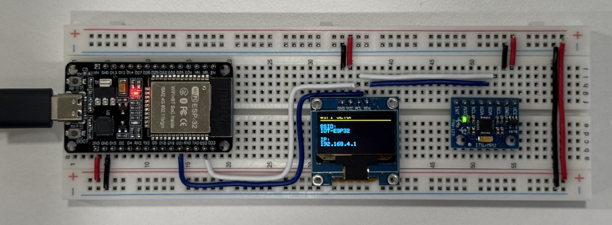
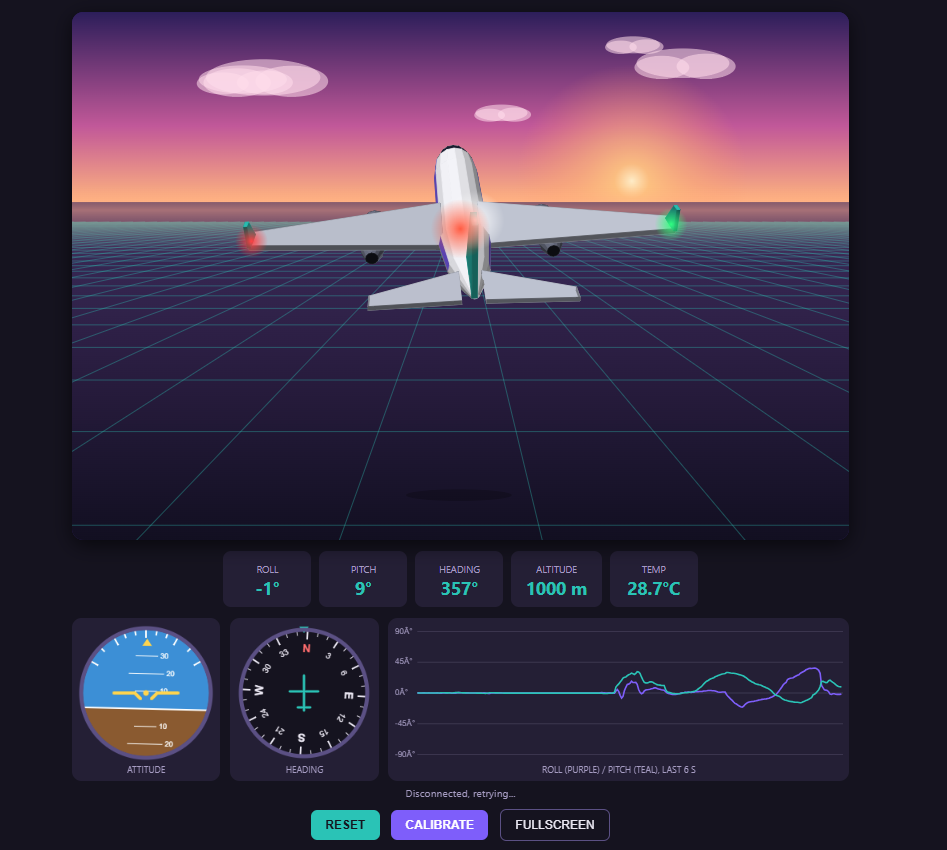
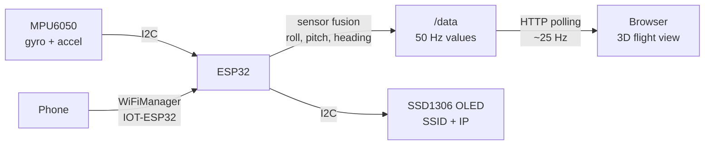

# ESP32 + MPU6050 Flight View ✈️

Tilt a breadboard and watch a 3D airplane follow it live in your web browser.

An ESP32 reads an **MPU6050** gyroscope/accelerometer, works out the board's roll, pitch and heading, and serves a web page that shows a 3D airplane flying over a sunset landscape, with cockpit instruments, a live graph and warnings. Wi-Fi is set up from your phone with **WiFiManager**, and a small **SSD1306 OLED** shows the network name and IP address so you always know where to connect.




---

## Contents

- [Features](#features)
- [Hardware](#hardware)
- [Wiring](#wiring)
- [Libraries](#libraries)
- [Upload](#upload)
- [First start: connecting to Wi-Fi](#first-start-connecting-to-wi-fi)
- [Using it](#using-it)
- [How it works](#how-it-works)
- [Settings you can tune](#settings-you-can-tune)
- [Web endpoints](#web-endpoints)
- [Troubleshooting](#troubleshooting)
- [Security notes](#security-notes)
- [Credits](#credits)

---

## Features

**Web page (served by the ESP32, no internet needed)**
- 3D airplane seen from behind, following the sensor's roll, pitch and heading
- Sunset sky, clouds, and a moving ground grid
- **Altitude:** nose up climbs, nose down descends; the shadow shrinks as you climb
- Cockpit **attitude indicator** and **heading compass**
- Live **roll / pitch graph** (last 6 seconds)
- Readouts: roll, pitch, heading, altitude, sensor temperature
- Warnings: **BANK ANGLE** (> 45°), **PULL UP**, **STALL**
- Blinking navigation lights (red left, green right, white strobe)
- **RESET**, **CALIBRATE** and **FULLSCREEN** buttons (fullscreen keeps the instruments on screen)
- **Axis settings** to flip or swap axes if your sensor is mounted differently (saved in the browser)

**ESP32**
- Sensor fusion (complementary filter) for stable roll and pitch
- Startup gyro calibration, plus automatic drift correction while the board is resting
- Correct heading even when the board is tilted while turning
- **WiFiManager:** choose the Wi-Fi network from your phone, no password in the code
- Saved Wi-Fi is **erased on every reboot** (see [Security notes](#security-notes))
- **OLED** shows only the network name (SSID) and IP address

---

## Hardware

| Part | Notes |
|---|---|
| ESP32 dev board | Any ESP32-WROOM board (tested layout: 38-pin, USB-C) |
| MPU6050 module | GY-521 / HW-123 |
| SSD1306 OLED | 0.96" 128×64, I2C, address `0x3C` |
| Breadboard + jumper wires | |

---

## Wiring

The MPU6050 and the OLED share the same I2C bus.

| Module pin | ESP32 pin |
|---|---|
| MPU6050 **VCC** | 3.3V |
| MPU6050 **GND** | GND |
| MPU6050 **SDA** | GPIO 21 |
| MPU6050 **SCL** | GPIO 22 |
| OLED **VCC** | 3.3V |
| OLED **GND** | GND |
| OLED **SDA** | GPIO 21 |
| OLED **SCL** | GPIO 22 |

Leave the MPU6050's `XDA`, `XCL`, `AD0` and `INT` pins unconnected.

### Sensor placement

Mount the MPU6050 **flat, chip side up**, firmly on the breadboard:

```
            NOSE (away from you)
                  ▲
                  │  Y arrow
        ┌─────────┴─────────┐
  LEFT  │      MPU6050      │──► X arrow = RIGHT wing
        │    (chip up)      │
        └───────────────────┘
            TAIL (toward you)
```

- **Y arrow** printed on the board → the airplane's **nose**
- **X arrow** → the airplane's **right wing**
- Tilt the **whole breadboard**, not the sensor alone, and keep cables loose so they don't pull the board.

---

## Libraries

### ESP32 board package

| Item | Value |
|---|---|
| Name in Boards Manager | **esp32** by **Espressif Systems** |
| Install from | Arduino IDE → **Tools → Board → Boards Manager…** → search `esp32` |
| Additional Boards Manager URL (only if it doesn't appear) | `https://espressif.github.io/arduino-esp32/package_esp32_index.json`<br/>(add it in **File → Preferences → Additional boards manager URLs**) |
| Source | https://github.com/espressif/arduino-esp32 |

These libraries are **included with the ESP32 board package**, so there's nothing to install:

| Header | Library |
|---|---|
| `#include <WiFi.h>` | WiFi |
| `#include <WebServer.h>` | WebServer |
| `#include <Wire.h>` | Wire (I2C) |

### Libraries to install

Install from **Sketch → Include Library → Manage Libraries…** (Library Manager). Type the name in the search box exactly as shown in the first column.

| Search name in Library Manager | Author | Header used in the sketch | Source |
|---|---|---|---|
| **WiFiManager** | tzapu | `#include <WiFiManager.h>` | https://github.com/tzapu/WiFiManager |
| **Adafruit MPU6050** | Adafruit | `#include <Adafruit_MPU6050.h>` | https://github.com/adafruit/Adafruit_MPU6050 |
| **Adafruit Unified Sensor** | Adafruit | `#include <Adafruit_Sensor.h>` | https://github.com/adafruit/Adafruit_Sensor |
| **Adafruit SSD1306** | Adafruit | `#include <Adafruit_SSD1306.h>` | https://github.com/adafruit/Adafruit_SSD1306 |
| **Adafruit GFX Library** | Adafruit | `#include <Adafruit_GFX.h>` | https://github.com/adafruit/Adafruit-GFX-Library |
| **Adafruit BusIO** | Adafruit | *(used inside the Adafruit libraries)* | https://github.com/adafruit/Adafruit_BusIO |

> When you install **Adafruit MPU6050** or **Adafruit SSD1306**, the IDE asks to install their dependencies (Unified Sensor, GFX, BusIO). Click **Install all**.
>
> WiFiManager by **tzapu** is the correct one. Several libraries have similar names, so check the author.

### Where the libraries are installed

Libraries from the Library Manager go into your **sketchbook `libraries` folder**:

| OS | Location |
|---|---|
| Windows | `Documents\Arduino\libraries\` |
| macOS | `~/Documents/Arduino/libraries/` |
| Linux | `~/Arduino/libraries/` |

You can check or change the sketchbook folder in **File → Preferences → Sketchbook location**.

The built-in ESP32 libraries (`WiFi`, `WebServer`, `Wire`) live inside the board package:

| OS | Location |
|---|---|
| Windows | `%LOCALAPPDATA%\Arduino15\packages\esp32\hardware\esp32\<version>\libraries\` |
| macOS | `~/Library/Arduino15/packages/esp32/hardware/esp32/<version>/libraries/` |
| Linux | `~/.arduino15/packages/esp32/hardware/esp32/<version>/libraries/` |

### Install from the command line (optional)

**arduino-cli**
```bash
arduino-cli core install esp32:esp32
arduino-cli lib install "WiFiManager" "Adafruit MPU6050" "Adafruit Unified Sensor" \
                        "Adafruit SSD1306" "Adafruit GFX Library" "Adafruit BusIO"
```

**PlatformIO** (`platformio.ini`)
```ini
[env:esp32dev]
platform = espressif32
board = esp32dev
framework = arduino
monitor_speed = 115200
lib_deps =
    tzapu/WiFiManager
    adafruit/Adafruit MPU6050
    adafruit/Adafruit Unified Sensor
    adafruit/Adafruit SSD1306
    adafruit/Adafruit GFX Library
    adafruit/Adafruit BusIO
```

> This version uses the built-in `WebServer`, not ESPAsyncWebServer, because WiFiManager is built on `WebServer` and the two can conflict. If you have **ESPAsyncWebServer** or **AsyncTCP** in your `libraries` folder from an older version of this project, you can delete them.

---

## Upload

1. Install the **ESP32 board package** in Arduino IDE (Boards Manager → "esp32" by Espressif).
2. Install the libraries above.
3. Open `mpu6050_airplane/mpu6050_airplane.ino`.
4. Select your board (e.g. **ESP32 Dev Module**) and port.
5. Click **Upload**.
6. Open the **Serial Monitor** at **115200 baud** to see status messages.

---

## First start: connecting to Wi-Fi

Because saved Wi-Fi is erased on every reboot, these steps run **every time the ESP32 powers up**.

1. The OLED shows:
   ```
   WIFI SETUP
   ─────────────
   SSID:
   IOT-ESP32
   IP:
   192.168.4.1
   ```
2. On your phone, connect to the Wi-Fi network **IOT-ESP32**.
3. The WiFiManager page opens automatically (if not, open **192.168.4.1**).
4. Tap **Configure WiFi**, pick your network, enter the password, and save.
5. The ESP32 joins your network and the OLED shows:
   ```
   CONNECTED
   ─────────────
   SSID:
   <your network>
   IP:
   <ESP32 IP address>
   ```
6. Reconnect your phone or PC to your normal Wi-Fi and open **http://&lt;ESP32 IP address&gt;**.

> Keep the board **flat and still** for about 3 seconds after it connects. That's when the gyro is calibrated.

---

## Using it

| Move the board | The airplane |
|---|---|
| Lift the far end | Nose up and climbs |
| Lower the far end | Nose down and descends |
| Lift the left side | Banks right |
| Lift the right side | Banks left |
| Rotate flat on the table | Turns (heading changes) |

| Button | What it does |
|---|---|
| **RESET** | Current position becomes level, heading resets to 000°, altitude back to start |
| **CALIBRATE** | Re-measures the gyro offset (keep the board still for ~2.5 s) |
| **FULLSCREEN** | Fills the screen with the flight view, instruments float on top |
| **Axis settings** | Flip roll / pitch / yaw or swap roll and pitch if the movement doesn't match |

### If the airplane moves the wrong way

Open **Axis settings** and test one axis at a time:

1. Lift the far end. Nose should go **up**; otherwise press **Flip Pitch**.
2. Lift the left side. Airplane should bank **right**; otherwise press **Flip Roll**.
3. Rotate the board left. Airplane should turn **left**; otherwise press **Flip Yaw**.
4. If lifting the far end makes it **bank** instead, press **Swap Roll/Pitch** and repeat.

The choices are saved in that browser.

---

## How it works



### On the ESP32

1. **Calibration:** at startup, 500 gyro samples are averaged to find the gyro's offset (bias) while the board is still.
2. **Rest detection:** when the board hasn't moved for 0.8 s, the gyro bias is slowly re-learned (it changes as the chip warms up) and the angles are held, so the heading can't drift.
3. **Rotation conversion:** gyro readings are converted into true roll, pitch and heading rates using the current tilt, so turning while tilted still gives the right heading.
4. **Complementary filter:** 98% gyro (fast, smooth) and 2% accelerometer (gravity, no long-term drift) for roll and pitch:
   ```
   angle = 0.98 × (angle + gyroRate × dt) + 0.02 × accelAngle
   ```
5. **Output smoothing:** values are smoothed and stored 50 times per second as `roll,pitch,yaw,temperature` (radians, °C).

### In the browser

- The page fetches `/data` about every 40 ms.
- The airplane is a small 3D model drawn on an HTML `<canvas>` with plain JavaScript. No external libraries, so it works without internet.
- Displayed angles glide toward the sensor values for smooth motion.
- Altitude is calculated in the browser from pitch (with a 6° dead zone so a slightly tilted table doesn't make it climb).

### Heading limitation

The MPU6050 has no compass, so heading comes only from the gyro. Roll and pitch are always corrected by gravity, but heading can drift a few degrees after a lot of fast turning. Point the board forward and press **RESET** to realign.

---

## Settings you can tune

**In the sketch (ESP32 side)**

| Setting | Default | Effect |
|---|---|---|
| `ALPHA` | `0.98` | Gyro vs. accelerometer mix. Higher = smoother, slower drift correction |
| `GYRO_DEADBAND` | `0.005` | rad/s of gyro noise to ignore |
| `BIAS_LEARN` | `0.002` | How fast the gyro offset is re-learned while resting |
| `OUT_SMOOTH` | `0.3` | Output smoothing (0.1 smooth … 1.0 raw) |
| `MPU6050_BAND_10_HZ` | 10 Hz | Sensor's built-in low-pass filter |

**In the web page (`<script>` section)**

| Setting | Default | Effect |
|---|---|---|
| `SMOOTH` | `0.15` | On-screen smoothing, lower = smoother |
| `CLIMB_SPEED` | `45` | How fast the airplane climbs/descends |
| `DEAD` | `6°` | Pitch needed before altitude changes |
| `ALT_MAX` | `100` | Ceiling (shown as 1000 m) |

---

## Web endpoints

| Path | Method | Returns |
|---|---|---|
| `/` | GET | The flight view page |
| `/data` | GET | `roll,pitch,yaw,temperature` as plain text, e.g. `0.120,-0.034,1.570,27.4` |
| `/reset` | GET | Sets the current position as level, heading to 0 |
| `/calibrate` | GET | Re-runs gyro calibration |

---

## Troubleshooting

| Problem | Fix |
|---|---|
| OLED stays blank | Check wiring; try address `0x3D` in `display.begin(...)`. If your OLED is an **SH1106**, it needs the `Adafruit_SH110X` library instead |
| `MPU6050 not found` in Serial Monitor | Check SDA/SCL wiring and 3.3V power |
| `IOT-ESP32` network doesn't appear | Press the ESP32's **EN/RST** button; check the Serial Monitor |
| WiFiManager page doesn't open | Open **192.168.4.1** manually while connected to `IOT-ESP32` |
| Page shows "Disconnected, retrying..." | Make sure your device is on the **same Wi-Fi** as the ESP32 and the IP matches the OLED |
| Airplane drifts while the board is still | Put the board on a hard flat surface and press **CALIBRATE** |
| Airplane moves the wrong way | Use **Axis settings** (see [above](#if-the-airplane-moves-the-wrong-way)) |
| Heading slowly off | Normal for the MPU6050 (no compass); press **RESET** |
| Fullscreen doesn't work on iPhone | iPhone Safari doesn't allow fullscreen for part of a page |
| Compile errors about `HTTP_GET` | Remove ESPAsyncWebServer from your libraries folder; this sketch uses `WebServer` |

---

## Security notes

- The ESP32 stores Wi-Fi credentials in its flash memory (NVS) **as plain text**. Anyone with physical access and a USB cable could read them by dumping the flash, unless ESP32 flash encryption is enabled.
- This sketch calls `wm.resetSettings()` at **every boot**, which erases the saved network name and password. The trade-off is that you must set up Wi-Fi each time it powers on.
- The credentials are still in flash **while the board is running**, until the next reboot erases them.
- The setup network `IOT-ESP32` is open (no password). To protect it, use `wm.autoConnect("IOT-ESP32", "yourpassword")` (password must be at least 8 characters).
- The web page has no login. Anyone on the same network can view it and press RESET / CALIBRATE.

---

## Credits

- Started from the [Random Nerd Tutorials ESP32 MPU-6050 Web Server](https://RandomNerdTutorials.com/esp32-mpu-6050-web-server/) project, then rewritten with sensor fusion, the 3D flight view, WiFiManager and OLED support.
- [WiFiManager](https://github.com/tzapu/WiFiManager) by tzapu
- [Adafruit MPU6050](https://github.com/adafruit/Adafruit_MPU6050), [Adafruit SSD1306](https://github.com/adafruit/Adafruit_SSD1306), [Adafruit GFX](https://github.com/adafruit/Adafruit-GFX-Library)

---

## Project structure

```
esp32-mpu6050-flight-view/
├── README.md
├── docs/
│   └── flight-view.png          # screenshot of the web page
└── mpu6050_airplane/
    └── mpu6050_airplane.ino     # the complete sketch (ESP32 code + web page)
```
